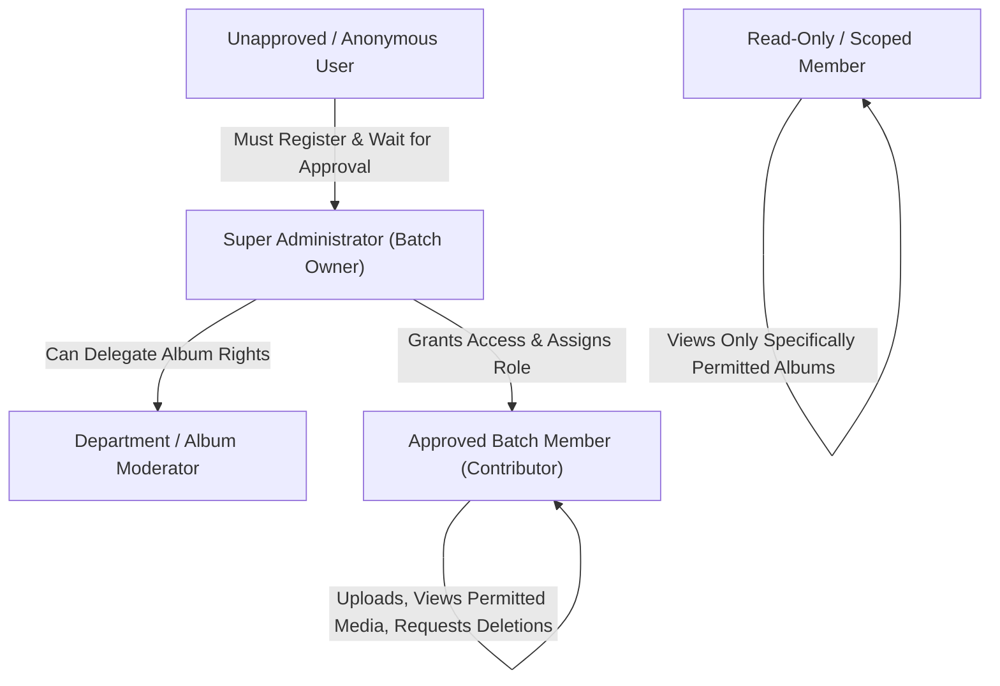
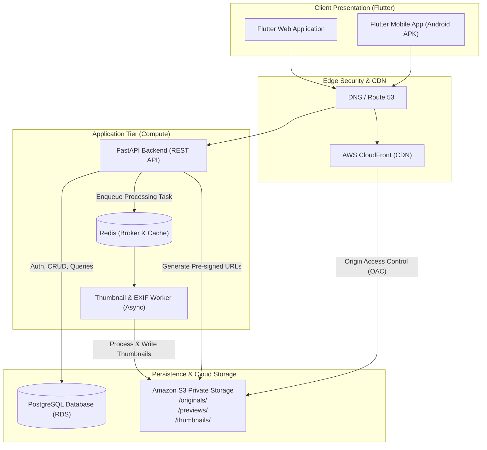
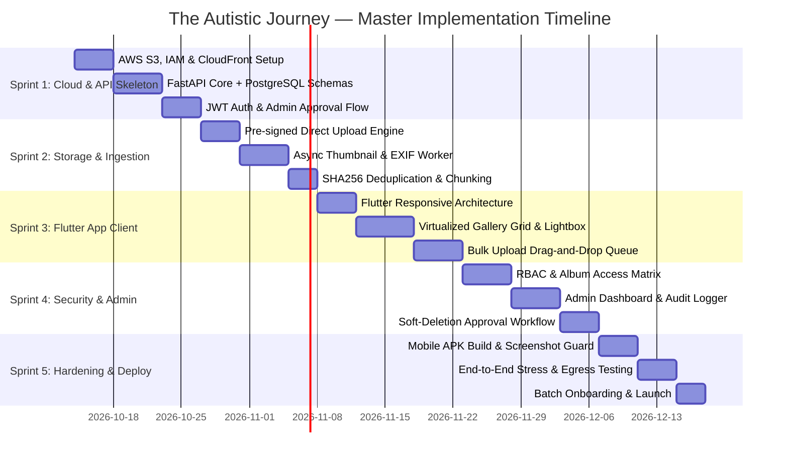

# 📋 Master Product Requirement Document (PRD) & Master Project Plan
## Project: The Autistic Journey — Private College Batch Gallery Archive

---

## Document Control
- **Project Name**: The Autistic Journey (College Gallery Archive)
- **Document Version**: 1.0.0 (Master)
- **Target Audience**: Exclusive College Batch Members (~60–250 verified users)
- **Primary Cloud Infrastructure**: AWS Asia Pacific Mumbai (`ap-south-1`)
- **Primary Client Framework**: Flutter Multi-Platform (Web & Android/iOS)
- **Primary Backend Stack**: Python 3.11+ (FastAPI), PostgreSQL, Celery/Redis Worker Engine

---

## 1. Product Overview & Vision

### 1.1 Problem Statement
College memories (academic years 1 through 4) are fragmented across WhatsApp groups, Telegram chats, personal Google Drive folders, and individual phone storage. Over time:
- Media gets deleted, compressed beyond recognition, or lost when members change phones.
- Public social networks (Instagram, Facebook) are unsuitable due to privacy concerns and lack of chronological/departmental organization.
- Google Drive lacks proper gallery curation, metadata indexing, granular role-based permissions, and batch-event browsing.

### 1.2 Solution Statement
**The Autistic Journey** is a private, zero-trust, high-performance digital memory vault designed exclusively for your college batch. It combines:
1. **Google Photos–style visual experience**: Fast virtualized grid rendering, chronological and event-driven timeline.
2. **Strict privacy by design**: No public links, no indexing, admin-approved user registration, role-based visibility, and zero client-side file exposure.
3. **Enterprise-grade media scale**: Built to accommodate 100,000+ high-resolution photos and videos over 4+ academic years utilizing AWS S3 direct pre-signed upload pipelines and automated thumbnail processing.
4. **No AI gimmicks**: Strictly focused on authentic human archiving—organized by Academic Year, Events, Dates, Groups, and Tags without invasive facial recognition or automated scraping.

---

## 2. User Personas & Roles



### 2.1 Role Definitions
1. **Super Administrator**:
   - Total control over user approval, role assignments, and account suspension.
   - Unrestricted access to system audit logs, storage quotas, and deletion requests.
   - Master authority to permanently purge or restore soft-deleted media.
2. **Moderator / Co-Admin**:
   - Manages specific albums or academic years (e.g., Symposium lead, Cultural head).
   - Can approve upload submissions within assigned collections.
3. **Approved Member (Contributor)**:
   - Authenticated student who has been verified by the administrator.
   - Can browse batch-wide events, create group-specific albums, and bulk-upload media.
   - Can request deletion of media they uploaded or report content.
4. **Restricted Member**:
   - Can only view explicitly permitted albums (e.g., external invitees or scoped batchmates).
   - Upload permissions disabled.
5. **Anonymous / Unauthenticated**:
   - Denied all access. No public landing page revealing batch photos, names, or metadata.

---

## 3. Functional Requirements (FR)

### Module A: Authentication & User Lifecycle
- **FR-A01 (Admin-Gated Registration)**: Self-registration requires Full Name, College Roll/Registration No, Email, Batch Year, and optional Profile avatar.
- **FR-A02 (Account Approval Gate)**: New accounts enter `PENDING_APPROVAL` status. System prevents login until an administrator explicitly approves the record.
- **FR-A03 (Session Management)**: Secure JWT token flow (short-lived Access Token 15 min, rotating Refresh Token 7 days in HTTP-only/secure storage).
- **FR-A04 (Role-Based Access Control - RBAC)**: Every API endpoint enforces role verification at the middleware layer.

### Module B: Media Organization & Taxonomy
- **FR-B01 (Hierarchical Structure)**:
  ```
  Academic Year (e.g. 1st Year, 2nd Year, 3rd Year, Final Year)
    └── Event Category (e.g. Department, Symposium, Culturals, Hostel, Trips)
         └── Album (e.g. "Zyverse 2K26 - Day 1 Stage Events")
              └── Media Items (Photos, Videos)
  ```
- **FR-B02 (Temporal Metadata Split)**:
  - System must capture and display two distinct timestamps:
    1. `taken_at`: Extracted directly from photo EXIF metadata (fallback to user input).
    2. `uploaded_at`: Server timestamp when file was processed into S3.
- **FR-B03 (Album Visibility Scopes)**:
  - `BATCH_WIDE`: Visible to all approved batch members.
  - `GROUP_ONLY`: Visible only to explicitly selected user groups (e.g., Hostel Block B, Specific Department).
  - `RESTRICTED`: Visible only to an explicit list of user IDs.

### Module C: Ingestion & Upload Engine (100,000+ Items Architecture)
- **FR-C01 (Direct S3 Pre-Signed Upload)**: Media bytes must never route through the FastAPI application server. The client requests a single-use S3 `PUT` presigned URL and uploads directly to AWS.
- **FR-C02 (Bulk Selection & Drag-and-Drop)**: The Flutter client must support uploading up to 500 files per batch with concurrent queue management (maximum 4 parallel uploads to prevent network throttling).
- **FR-C03 (Client-Side Deduplication)**: Client computes SHA-256 hash of each file before upload; API checks against database. If hash already exists, upload is skipped and tagged into the target album immediately without re-uploading bytes.
- **FR-C04 (Chunked Resumable Uploads for Videos)**: For video files > 50MB, use S3 Multi-part Upload with presigned parts.

### Module D: Media Processing & Delivery
- **FR-D01 (Automated Async Thumbnailing)**: S3 upload triggers an asynchronous worker generating:
  - `thumb_sm`: 256x256 WebP (~20–30 KB) for high-speed grid rendering.
  - `preview_lg`: 1600x1200 WebP (~250–400 KB) for lightboxes and full-screen browsing.
  - `original`: Preserved untouched in cold/private storage tier.
- **FR-D02 (Signed Delivery Only)**: No public S3 URLs. All image requests return short-lived CloudFront or S3 signed URLs (valid for 15 minutes max).
- **FR-D03 (Progressive Virtualized Grid)**: Flutter client uses infinite scrolling with viewport recycling (`GridView.builder`), loading only images currently visible on screen.

### Module E: Moderation, Deletion & Audit Trail
- **FR-E01 (Immutable Soft-Deletion)**: Standard members cannot hard-delete media. Clicking "Delete" creates a `DELETION_REQUEST` with an optional reason.
- **FR-E02 (Admin Trash Vault)**: Approved deletions mark `is_deleted = true` and move items to a 30-day recovery vault before permanent S3 purge.
- **FR-E03 (Comprehensive Audit Logging)**: All security-critical events (Logins, Failed Auth, Permission Changes, Original Media Downloads, Deletion Approvals) are written to an append-only `audit_logs` table.

---

## 4. Non-Functional Requirements (NFR)

| Category | Requirement Specification |
| :--- | :--- |
| **Performance** | Initial gallery view must render within < 1.2s on standard 4G/Wi-Fi. Image grid scroll must maintain 60 FPS without UI jank. |
| **Storage & Cost** | Zero out-of-pocket costs within AWS Free Tier limit + $100 credit. Monthly burn rate capped at < $12/month when fully scaled to 400 GB. |
| **Security** | Zero direct public access to AWS S3. SQL injection protection via SQLAlchemy ORM. CORS locked strictly to client origins. Rate limiting on authentication (max 5 failed attempts / 15 min). |
| **Cross-Platform Compatibility** | 100% feature parity on Web (Chrome/Firefox/Safari/Edge) and Mobile (Android 9.0+, iOS 14.0+). |
| **Data Integrity** | Nightly automated metadata backup from RDS to an S3 backup bucket. Multi-AZ database snapshots enabled where applicable. |

---

## 5. System Architecture & Component Design



### 5.1 Storage Hierarchy in Amazon S3
```
s3://the-autistic-journey-vault-ap-south-1/
├── originals/
│   └── {academic_year}/{album_id}/{media_uuid}.{ext}   (Private, Cold Tier)
├── previews/
│   └── {album_id}/{media_uuid}_preview.webp             (1600px Max, WebP)
├── thumbnails/
│   └── {album_id}/{media_uuid}_thumb.webp               (256px Square, WebP)
└── avatars/
    └── {user_uuid}_avatar.webp
```

---

## 6. Comprehensive Data Model (PostgreSQL)

```sql
-- 1. Users & Profiles
CREATE TABLE users (
    id UUID PRIMARY KEY DEFAULT gen_random_uuid(),
    email VARCHAR(255) UNIQUE NOT NULL,
    hashed_password VARCHAR(255) NOT NULL,
    full_name VARCHAR(150) NOT NULL,
    roll_number VARCHAR(50) UNIQUE,
    batch_year VARCHAR(20) NOT NULL, -- e.g., '2023-2027'
    gender VARCHAR(20),
    role VARCHAR(30) DEFAULT 'MEMBER', -- 'SUPER_ADMIN', 'MODERATOR', 'MEMBER', 'READ_ONLY'
    status VARCHAR(30) DEFAULT 'PENDING_APPROVAL', -- 'PENDING_APPROVAL', 'ACTIVE', 'SUSPENDED'
    avatar_url VARCHAR(500),
    created_at TIMESTAMP WITH TIME ZONE DEFAULT CURRENT_TIMESTAMP,
    updated_at TIMESTAMP WITH TIME ZONE DEFAULT CURRENT_TIMESTAMP
);

-- 2. Albums & Collections
CREATE TABLE albums (
    id UUID PRIMARY KEY DEFAULT gen_random_uuid(),
    title VARCHAR(200) NOT NULL,
    description TEXT,
    academic_year VARCHAR(50) NOT NULL, -- 'First Year', 'Second Year', 'Third Year', 'Final Year'
    category VARCHAR(100) NOT NULL,     -- 'Symposium', 'Induction', 'Trip', 'Hostel', etc.
    event_date DATE,
    cover_media_id UUID,
    visibility_scope VARCHAR(30) DEFAULT 'BATCH_WIDE', -- 'BATCH_WIDE', 'GROUP_ONLY', 'RESTRICTED'
    created_by UUID REFERENCES users(id) ON DELETE SET NULL,
    is_archived BOOLEAN DEFAULT FALSE,
    created_at TIMESTAMP WITH TIME ZONE DEFAULT CURRENT_TIMESTAMP
);

-- 3. Album Member Access Permissions
CREATE TABLE album_permissions (
    id UUID PRIMARY KEY DEFAULT gen_random_uuid(),
    album_id UUID REFERENCES albums(id) ON DELETE CASCADE,
    user_id UUID REFERENCES users(id) ON DELETE CASCADE,
    can_view BOOLEAN DEFAULT TRUE,
    can_upload BOOLEAN DEFAULT FALSE,
    can_moderate BOOLEAN DEFAULT FALSE,
    granted_by UUID REFERENCES users(id),
    created_at TIMESTAMP WITH TIME ZONE DEFAULT CURRENT_TIMESTAMP,
    UNIQUE(album_id, user_id)
);

-- 4. Media Asset Table
CREATE TABLE media (
    id UUID PRIMARY KEY DEFAULT gen_random_uuid(),
    album_id UUID REFERENCES albums(id) ON DELETE CASCADE,
    uploader_id UUID REFERENCES users(id) ON DELETE SET NULL,
    original_s3_key VARCHAR(500) NOT NULL,
    preview_s3_key VARCHAR(500),
    thumb_s3_key VARCHAR(500),
    file_name VARCHAR(255) NOT NULL,
    mime_type VARCHAR(100) NOT NULL,
    file_size_bytes BIGINT NOT NULL,
    sha256_hash VARCHAR(64) NOT NULL,
    width INTEGER,
    height INTEGER,
    duration_seconds INTEGER, -- for video items
    taken_at TIMESTAMP WITH TIME ZONE,
    uploaded_at TIMESTAMP WITH TIME ZONE DEFAULT CURRENT_TIMESTAMP,
    visibility_override VARCHAR(30) DEFAULT 'INHERIT',
    is_deleted BOOLEAN DEFAULT FALSE,
    deleted_at TIMESTAMP WITH TIME ZONE,
    deleted_by UUID REFERENCES users(id)
);

CREATE INDEX idx_media_album_id ON media(album_id);
CREATE INDEX idx_media_taken_at ON media(taken_at);
CREATE INDEX idx_media_sha256 ON media(sha256_hash);

-- 5. Deletion & Moderation Requests
CREATE TABLE deletion_requests (
    id UUID PRIMARY KEY DEFAULT gen_random_uuid(),
    media_id UUID REFERENCES media(id) ON DELETE CASCADE,
    requested_by UUID REFERENCES users(id) ON DELETE CASCADE,
    reason TEXT,
    status VARCHAR(30) DEFAULT 'PENDING', -- 'PENDING', 'APPROVED', 'REJECTED'
    reviewed_by UUID REFERENCES users(id),
    reviewed_at TIMESTAMP WITH TIME ZONE,
    created_at TIMESTAMP WITH TIME ZONE DEFAULT CURRENT_TIMESTAMP
);

-- 6. Security Audit Trail
CREATE TABLE audit_logs (
    id UUID PRIMARY KEY DEFAULT gen_random_uuid(),
    user_id UUID REFERENCES users(id) ON DELETE SET NULL,
    action VARCHAR(100) NOT NULL, -- 'AUTH_LOGIN', 'MEDIA_UPLOAD', 'ORIGINAL_DOWNLOAD', 'ADMIN_USER_APPROVE'
    target_entity VARCHAR(50),
    target_id UUID,
    details JSONB,
    ip_address VARCHAR(50),
    user_agent TEXT,
    timestamp TIMESTAMP WITH TIME ZONE DEFAULT CURRENT_TIMESTAMP
);
```

---

## 7. Master Project Plan & Sprint Roadmap



### Sprint-by-Sprint Execution Details

#### Sprint 1: Cloud Infrastructure & Backend Core (Days 1–13)
- **Deliverables**:
  - AWS S3 bucket created in `ap-south-1` (`the-autistic-journey-vault`) with Block All Public Access enabled and proper CORS headers.
  - IAM Service User configured with restricted least-privilege policy.
  - PostgreSQL database instantiated (local docker for dev + AWS RDS Free Tier ready).
  - FastAPI skeleton with SQLAlchemy 2.0 async engine and Alembic migrations.
  - User registration, password hashing (`Argon2` or `bcrypt`), and admin approval API endpoints.

#### Sprint 2: Direct Upload Pipeline & Asynchronous Processing (Days 14–25)
- **Deliverables**:
  - S3 pre-signed `PUT` URL generation endpoint with MIME-type and size constraint enforcement.
  - Upload confirmation callback endpoint.
  - Celery/Pillow asynchronous processing pipeline:
    - Generates 256x256 WebP thumbnails.
    - Generates 1600px preview WebP images.
    - Extracts EXIF creation timestamp (`DateTimeOriginal`).
  - SHA-256 deduplication logic to prevent uploading identical files.

#### Sprint 3: Flutter Cross-Platform Client (Days 26–40)
- **Deliverables**:
  - Flutter workspace initialized with responsive desktop (Web) and phone (Android/iOS) navigation.
  - State management setup using Riverpod or BLoC.
  - Gallery browser:
    - Academic Year tabs (1st to 4th Year).
    - Event collections masonry grid.
    - Virtualized image grid with smooth infinite scrolling using `cached_network_image`.
    - Custom Lightbox with zoom, date taken vs. uploaded details, and uploader attribution.
  - Bulk uploader dialog:
    - Drag-and-drop multi-file picker.
    - Concurrency throttle (4 simultaneous uploads).
    - Real-time progress bars and retry mechanism.

#### Sprint 4: Security Matrix, Moderation & Admin Console (Days 41–54)
- **Deliverables**:
  - Granular album permission enforcement (Batch-wide vs. Group vs. Restricted).
  - Admin Web Dashboard:
    - User approval list (one-click Approve / Reject).
    - Storage consumption statistics.
    - Audit log viewer.
  - Deletion request workflow with soft-delete retention and admin restoration controls.

#### Sprint 5: Hardening, Mobile Distribution & Production Launch (Days 55–65)
- **Deliverables**:
  - Screenshot prevention (`FLAG_SECURE`) enabled on Flutter Android build.
  - Web context menu disabled (right-click / drag prevention).
  - Stress testing with a mock dataset of 5,000 photos.
  - CloudFront CDN distribution attached to S3 with Origin Access Control (OAC).
  - Production deployment of FastAPI backend and Flutter Web hosting.
  - Release of standalone Android APK for your college batch.

---

## 8. Risk Management & Mitigation Matrix

| Risk Event | Severity | Probability | Mitigation Strategy |
| :--- | :--- | :--- | :--- |
| **Accidental Out-of-Pocket AWS Costs** | High | Low | Set AWS Budget alerts at \$10, \$25, and \$50. Thumbnails/previews cached via CloudFront (1 TB/mo free egress). Originals stored in cold tier. |
| **API Server Memory Exhaustion** | High | Low | Direct S3 client uploads. Large files **never** pass through FastAPI memory or disk buffers. |
| **Batchmate Leaks / Unauthorized Sharing** | Medium | Medium | Watermarking previews with user ID/timestamp; short-lived signed URLs (15 min); OS-level screenshot blocking on mobile; comprehensive access audit logs. |
| **Accidental Loss of Irreplaceable Media** | Critical | Low | S3 Versioning enabled; Soft-delete retention (30 days minimum) before admin permanent purge; automated RDS backups. |
